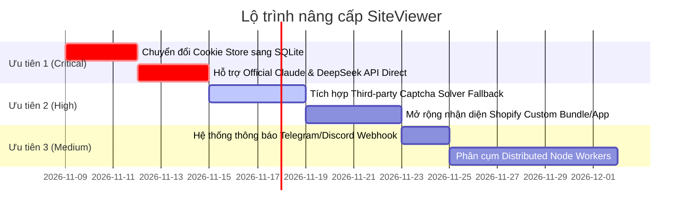

# SiteViewer V2.0.0 — Kế Hoạch & Tài Liệu Nâng Cấp Hệ Thống (Upgrade Roadmap)

Tài liệu này tổng hợp phân tích kỹ thuật chuyên sâu về hiện trạng của **SiteViewer V2.0.0** (`ai-storefront-simulator`) và đề xuất lộ trình nâng cấp chi tiết theo từng giai đoạn ưu tiên, nhằm tối ưu hóa độ ổn định, hiệu năng và khả năng tàng hình khi vận hành quy mô lớn.

---

## I. Tổng Quan Hiện Trạng Kỹ Thuật (Architecture Baseline)

| Hạng mục | Trạng thái hiện tại (V2.0.0) | Đánh giá |
| :--- | :--- | :--- |
| **Browser Kernel** | BitBrowser Local API + Ungoogled Chromium (`rebrowser-playwright`) | **Xuất sắc**: Không rò rỉ cờ CDP, cô lập context tốt |
| **Mô phỏng chuột** | Minimum-Jerk kinematic, rung cơ 8–12Hz, Lacquaniti Power Law, Fitts's Law | **Xuất sắc**: Chuột đi theo đường cong sinh học tự nhiên |
| **Nhận diện thành phần** | 3-Tier Waterfall (Tier 0: Recipe Cache, Tier 1: Oracle JSON, Tier 2: Claude AI) | **Rất tốt**: Nhanh, tiết kiệm token, tự hồi phục |
| **Bộ nhớ & CPU** | `AdaptiveLauncher`, `DeterministicMemoryManager`, `TabHibernation` | **Rất tốt**: Chống thundering herd, đóng băng tab ngầm |
| **Quản lý Cookie** | Lưu trữ từng file `.json` riêng lẻ trong thư mục `Cookies/` | **Hạn chế**: I/O cao khi chạy nhiều luồng |
| **Kết nối AI** | Claude Desktop Web API emulator (Cookie-based auth) | **Rủi ro**: Dễ bị vô hiệu khi Claude đổi cơ chế web |
| **Giải Captcha** | Biomechanical click giải Turnstile nhẹ; chưa có solver bên thứ 3 | **Cần bổ sung**: Bị chặn nếu gặp DataDome slider phức tạp |

---

## II. Lộ Trình Nâng Cấp Chi Tiết (Priority Action Items)



---

### Giai Đoạn 1: Cải Tiến Cốt Lõi & Độ Ổn Định (High Priority)

#### 1. Bổ sung Dual-Engine AI: Official Anthropic API song song Cookie Pool
- **Vấn đề**: `src/ai/claudeClient.ts` đang giả lập Claude Desktop app bằng cookie pool (`claude.ai/api`). Phương pháp này tiết kiệm chi phí nhưng phụ thuộc vào cookie session web. Khi Anthropic siết bảo mật web hoặc cookie hết hạn, Tier 2 sẽ fallback về `localFallback.ts`.
- **Giải pháp**:
  - Thêm cấu hình `ai.provider: "cookie_pool" | "anthropic_api" | "hybrid"` trong `src/config.ts`.
  - Hỗ trợ gọi trực tiếp qua `api.anthropic.com/v1/messages` (Claude 3.5 Haiku) với API Key chính thức.
  - Chế độ **Hybrid**: Ưu tiên dùng Cookie Pool để tiết kiệm chi phí; nếu gặp lỗi 401/403/Cloudflare challenge lập tức tự động failover sang API Key chính thức để phiên duyệt web không bị gián đoạn.

#### 2. Nâng cấp Cookie & Profile Storage sang SQLite (Thay thế File I/O)
- **Vấn đề**: Thư mục `Cookies/` và `tempprofolio/` chứa hàng nghìn file JSON nhỏ. Trên hệ điều hành Windows NTFS, việc mở, đọc và ghi liên tục hàng nghìn file gây nghẽn hàng đợi đĩa (Disk I/O bottle-neck) và dễ gặp lỗi file lock (`EBUSY`).
- **Giải pháp**:
  - Tích hợp SQLite nhúng (`better-sqlite3` hoặc Node.js 22 native `node:sqlite`).
  - Toàn bộ cookies, session storage, domain recipes và proxy statistics được lưu trong một file CSDL duy nhất `data/siteviewer.db`.
  - Tốc độ đọc ghi tăng gấp 15–20 lần, hỗ trợ transaction nguyên tử an toàn tuyệt đối khi chạy 50 luồng đồng thời.

---

### Giai Đoạn 2: Vượt WAF & Tương Tác Giỏ Hàng Nâng Cao (Medium Priority)

#### 3. Tích hợp Provider Giải Captcha Ngoài (Captcha Solver Fallback)
- **Vấn đề**: Hiện tại `wafDetector.ts` giải quyết rất tốt các rào cản Cloudflare Turnstile dạng hộp kiểm (checkbox) bằng thuật toán click sinh học `HumanCursor`. Tuy nhiên, nếu gặp DataDome Slider phức tạp hoặc Akamai Hard Interstitial, phiên làm việc sẽ bị timeout.
- **Giải pháp**:
  - Tích hợp module giải Captcha nền (CapSolver / 2Captcha / NextCaptcha API).
  - Khi `WafChallengeDetector.inspectPage()` phát hiện `datadome_slider` hoặc tương tác khó vượt qua sau 10 giây, tự động trích xuất token/sitekey gửi đến API giải mã và tiêm token trả về vào form.

#### 4. Nhận Diện Nâng Cao Cho Ứng Dụng Shopify Thứ Ba (3rd-Party App Handlers)
- **Vấn đề**: Một số thương hiệu lớn sử dụng các plugin bán hàng bên thứ 3:
  - Plugin gói sản phẩm (Recharge Subscription, Bold Bundles, Seal Subscriptions).
  - Khung tùy biến sản phẩm cá nhân hóa (Custom text engraving, file upload).
- **Giải pháp**:
  - Bổ sung heuristic trong `src/navigator/multiSignalDetector.ts` để tự động chọn tùy chọn mặc định (One-time purchase thay vì Subscribe) và điền dữ liệu giả lập cho các trường bắt buộc trước khi nhấn ATC.

---

### Giai Đoạn 3: Quản Trị Hạm Đội & Phân Cụm (Scale & Monitoring)

#### 5. Hệ Thống Cảnh Báo Realtime & Webhook (Telegram / Discord)
- Tích hợp Webhook bắn thông báo tức thì khi:
  - Tỷ lệ ATC thành công giảm bất thường trên một domain.
  - Dải Proxy IP bị dính blacklist hoặc dính Captcha liên tục.
  - Cookie Pool bị hết hạn hoặc rate-limit.

#### 6. Kiến Trúc Phân Tán (Distributed Fleet Orchestrator)
- Tách biệt Dashboard UI Server và Browser Runner Workers qua giao thức WebSocket / gRPC.
- Cho phép 1 máy chủ Dashboard điều phối hàng trăm trình duyệt chạy rải rác trên nhiều VPS/máy chủ khác nhau.

---

## III. Hướng Dẫn Kích Hoạt & Sử Dụng Hiện Tại

1. **Cài đặt thư viện**:
   ```bash
   npm install
   ```
2. **Build dự án**:
   ```bash
   npm run build
   ```
3. **Chạy kiểm thử hệ thống**:
   ```bash
   npm test
   ```
4. **Khởi chạy giao diện Web Dashboard**:
   ```bash
   npm start
   ```
   Sau đó truy cập: `http://127.0.0.1:7317` trên trình duyệt để điều khiển hạm đội trình duyệt.
